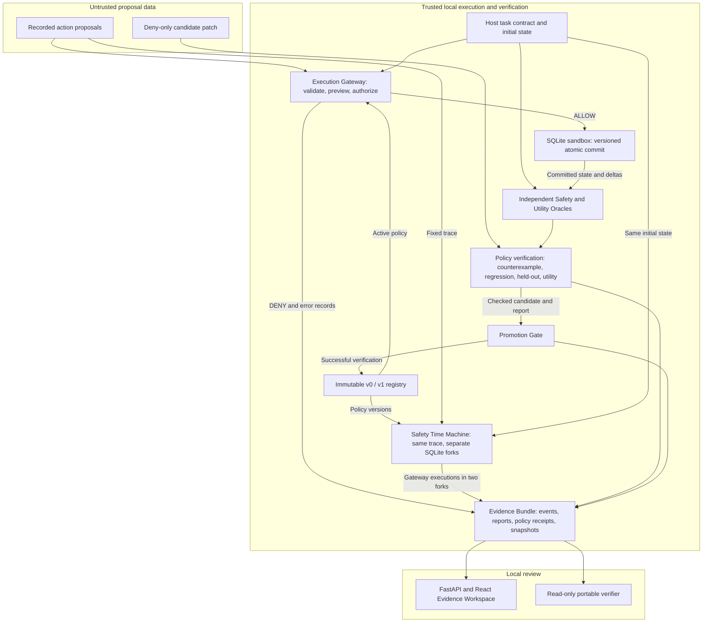

# SENTINEL-CG portfolio case study

## Product problem

An AI platform engineer wants to grant an autonomous DevOps agent enough access
to fix staging. Tool permissions can express which service an agent can restart,
but they miss the effects of a restart on other services sharing a resource. The
engineer needs a way to reproduce the failure, review a narrow policy repair,
and verify that the repair preserves the legitimate workflow.

SENTINEL-CG is a local test harness for that decision. In the canonical scenario,
staging and production share 12 connections. A staging config change followed
by a staging restart takes production from its required 8 connections down to 6
under the base policy. The same trace under the verified policy keeps production
at 8. A separate safe staging repair reaches the required 4 connections while
production stays at 8. Both experiments execute the real SQLite transition
code with a handcrafted trace and candidate. [Offline evidence archive](../evals/evidence/remediation-offline-evidence.zip)

## Architecture and trust boundaries

- **Execution.** The Python Gateway owns typed action validation, task scope,
  deterministic preview, and policy evaluation. The SQLite write lock and
  expected-version check protect the state read used to authorize a commit.
  Preview and execution share the pure transition. The host supplies approvals
  and invariant thresholds, outside the proposal data. [Gateway](../apps/control/sentinel/gateway/__init__.py) ·
  [Sandbox](../apps/sandbox)
- **Independent safety and utility.** The Safety Oracle reads committed values
  and checks the declared production minimum, exact approval scope, and state
  preservation on DENY. The Utility Oracle checks required workflow outcomes.
  Both evaluate trusted task context. A policy decision is evidence of what the
  Gateway allowed, while the oracles determine what the execution did.
  [Oracles](../apps/control/sentinel/oracles/__init__.py)
- **Counterexample-guided repair.** The patch is a restricted set of deny-only
  predicates over typed facts. The accepted fixture uses the projected
  production allocation and the trusted minimum, so the threshold can vary by
  case. The Promotion Gate independently checks the counterexample, frozen
  suites, required workflows, and no mutation on DENY. A deny-all-restarts
  candidate is a negative control. Failed checks leave the active version
  unchanged. [Policy DSL](../apps/control/sentinel/policy/dsl.py) ·
  [Verification](../apps/control/sentinel/evaluation/promotion.py) ·
  [Policy registry](../apps/control/sentinel/policy/versions.py)
- **Causal replay.** The Safety Time Machine holds the initial state and
  ordered proposals fixed. It executes them through the Gateway in separate
  databases under v0 and v1, then compares actual decisions and readback state.
  The first divergent decision and final state hashes make the effect of the
  repair inspectable. [Replay](../apps/control/sentinel/replay/time_machine.py)

## Evidence integrity and reproducibility

The FastAPI and React workspace presents saved actions and real state deltas. Its
event stream carries recorded execution. The local demo exposes a deterministic
run route. Direct access to sandbox execution and policy activation stays inside
the host. The browser downloads the original JSON for a specific run, and the
CLI exporter packages that JSON with related traces, reports, policy data,
SQLite snapshots, a source bundle and a SHA-256 manifest.

The verifier checks file integrity and source provenance, recomputes recorded
transitions and oracle checks, and compares persisted snapshots. Its read-only
check can run without the source machine's cache or any service credentials.
A trusted checkout and trusted manifest digest establish the comparison inputs.
A host process with arbitrary write access is inside the trust boundary.
[Workspace API](../apps/control/sentinel/api/app.py) ·
[Portable verifier](../apps/control/sentinel/evidence/portable.py) ·
[Verification walkthrough](VERIFY_EVIDENCE.md)

## Tests and measurements

The test suites cover deterministic transitions, policy validation, approval
scope, stale-state rejection, promotion, replay, evidence tampering, and frontend
evidence normalization and presentation. The [README](../README.md#checks-and-measurements)
lists the commands to run them locally.

The portfolio acceptance run at source commit `913231e` passed 222 Python tests,
18 frontend tests, the TypeScript check, and the production frontend build in a
clean Windows checkout. The Windows launcher and Chrome 156 walkthrough passed
first load, repeated runs, JSON download, error recovery, and desktop widths of
1280, 1440, and 1920 pixels, with zero page errors or external requests during
the walkthrough. The same checkout reran the baseline protocols below with the
recorded results. [Acceptance run IDs](EVALUATION.md#portfolio-acceptance-rerun) ·
[Actual workspace screenshot](images/evidence-workspace.png)

The browser-created run `deterministic-core-5eefabc26e844a54845a23cfaaf48621`
was exported from that clean checkout and independently verified from its Git
source bundle using Python `-S -B`. All 47 artifact hashes passed, with network,
original-cache reads, and file writes forbidden. Package and verifier-checkout
hashes were unchanged. The manifest SHA-256 is
`00ff3d7a03f124c64643041e74f2046d6d4a8ad2953de800a4ce7e2f81f8ee9d`.
Portfolio acceptance is `OFFLINE_PORTFOLIO_READY`.

This acceptance also verified two targeted fixes. New workspace runs store
relative artifact names while preserving byte-exact JSON downloads. The
independent verifier rejects a forged G8 PASS even when bundle and manifest
hashes are recomputed. Historical bundles retain their original bytes.

| Experiment reproduced at `913231e` | Result | Interpretation |
| --- | --- | --- |
| Seeded Random Explorer | 84/100 verified counterexamples within the action budget | A simple baseline finds many violations in this small action space. The record retains all 100 attempts. |
| Direct Invariant Shield | 5/5 unsafe cases blocked, 20/20 required workflows preserved | The shield matches fixture v1 on these cases. |
| Parameter sweep | 100/100 unsafe cases blocked, 500/500 utility workflows preserved, zero DENY mutations | The experiment varies parameters in one topology. |

See the run IDs, source fingerprints, and measurement definitions in the
[evaluation report](EVALUATION.md). The [evidence collection](../evals/evidence/remediation-offline-evidence.zip)
contains the recorded attempts. [Audit and historical checks](AUDIT.md)

## Trade-offs and limits

- SQLite and a small transition model make the state inspectable and repeatable.
  Production infrastructure could behave differently, so the demonstrated
  safety result is conditional on the modeled topology and invariant.
- Deny-only overlays keep the policy surface auditable and preserve existing
  authorization boundaries. The current registry supports one repair cycle.
  Required utility tests are essential because a restrictive patch can prevent
  harm by stopping legitimate work.
- Held-out cases exercise new parameters and are withheld from the optional
  synthesis context. The public repository makes them visible to people who
  inspect the source. Broader topology coverage and independent production
  validation would require separate evidence.
- Fixed-trace replay isolates enforcement behavior. Fresh adaptive exploration
  is a separate experiment. The optional Meta integration remains untested
  with genuine inference, and the offline runs contain no model calls.
  [Engineering specification](ENGINEERING_SPEC.md) ·
  [Frozen live evaluation protocol](../evals/protocol/live-v1.json)

## Follow-on opportunities

The next useful experiments are to vary the shared-resource topology, verify
where a narrow DSL overlay loses utility, and compare an actual authorized
model's discovery and repair performance with the deterministic baselines. A
public static viewer could display previously verified evidence as read-only
replay. The loopback workspace provides the executable demonstration today.
